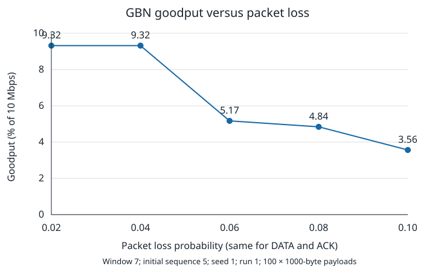

# Go-Back-N over UDP — COMP 4300 Computer Networks

This individual course project implements Go-Back-N reliable data transfer over UDP in C++ using ns-3.49.

> **Coursework publication boundary:** this repository is a verified case study, not a public answer key. Raw assignment source and student-derived identifiers are intentionally withheld.

## What I implemented

- A sliding-window sender with cumulative acknowledgements
- Modulo sequence-number handling and wraparound
- One timer for the oldest outstanding packet
- Full-window retransmission after timeout
- Receiver handling for duplicate and out-of-order data
- Independent DATA and ACK loss models
- PCAP and CSV-based protocol validation

## Verification

A fresh November 2026 run rebuilt the target against ns-3.49 and passed:

- no-loss transfer;
- DATA-loss and ACK-loss scenarios;
- five equal-loss scenarios from 0.02 through 0.10;
- deterministic repeated-run PCAP checks;
- complete DATA-loss and ACK-loss edge cases; and
- invalid-parameter rejection.

All 100 packets were delivered in every recoverable scenario. The checked evidence is included under [`evidence/`](evidence/).

## Stack

- C++
- ns-3.49
- UDP
- Python validation tooling
- tshark, PCAP, and CSV analysis

## Demo availability

There is no browser demo because the project requires a compatible ns-3 environment. The repository provides measured validation evidence and an implementation overview instead.

## Portfolio

[View the project in my portfolio](https://damilola-durodola.vercel.app/#go-back-n-over-udp)
